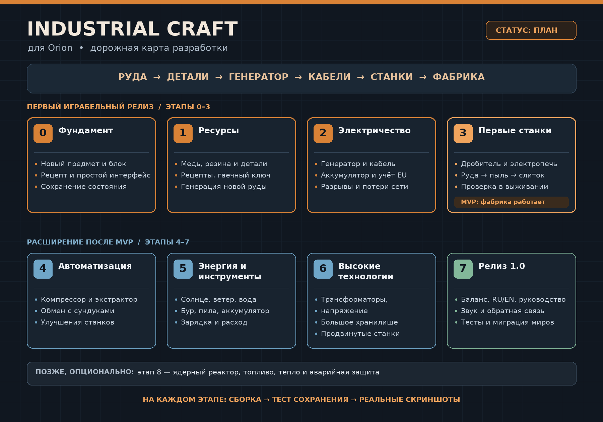

# Industrial Craft for Orion — план проекта

**Статус:** проектирование. Игровые механики Industrial Craft ещё не реализованы.
**Визуальная база:** принятая текстурная сборка v0.5, коммит `9de6d58`.
**Рабочее название:** *Industrial Craft for Orion*; внутреннее сокращение — `IC`.
**Согласовано:** адаптация под Orion; первый релиз — генератор, кабель, аккумулятор, дробитель и электропечь; новые ресурсы старта — медь и резина из существующей смолы.



## 1. Что именно делаем

Превращаем Orion в 2D survival-игру про развитие производства: от кирки и печи к электрической сети, станкам, переработке руды, автоматизации и мощной энергетике.

Ориентир — идеи IndustrialCraft, но баланс, интерфейс и размеры механизмов адаптируются под Orion. Это не буквальная копия Minecraft-мода и не перенос его текстур. Новые спрайты рисуем в стиле Orion; уже принятые дубы, камень, руды, стены и броня остаются базой.

**Главный игровой цикл:**

```text
Добыча ресурсов
  → медь / смола / железо
  → резина, провода, пластины, детали
  → генератор + кабели + аккумулятор
  → дробитель и электрическая печь
  → больше металла с той же руды
  → новые станки и источники энергии
  → автоматическая фабрика
  → высокие технологии
```

### Зафиксированные решения

- **Адаптация под Orion**, а не воспроизведение всех формул IC2 один в один.
- **Первый играбельный релиз:** топливный генератор, кабель, аккумулятор, дробитель и электрическая печь. Инструменты и автоматизация приходят следующими этапами.
- **Ресурсы старта:** новая медная руда и резина из уже существующей смолы. Бронзовую руду Orion сохраняем; олово и свинец добавляем позже только при необходимости.

### Рабочие правила

- Сначала **одиночная игра и локальное сохранение**. Сетевую игру и облачные сохранения не обещаем до отдельного технического этапа.
- Не ломаем начало игры: дерево, камень, верстак, печь и наковальня остаются полезными.
- Добавляем контент, а не заменяем существующие предметы без необходимости.
- Первый играбельный выпуск — маленькая законченная фабрика, а не сразу ядерный реактор и десятки станков.
- Каждый этап заканчивается сборкой, проверкой сохранения и реальными игровыми скриншотами.

## 2. Этапы

Нумерация геймплейного модуля `IC` будет отдельной от нумерации текстурного пака.

| Этап | Результат | Что проверяем перед переходом дальше |
|---|---|---|
| **0. Технический фундамент** | Один новый предмет, блок, рецепт и простейший работающий механизм; загрузка мода и сохранение состояния | Предмет виден, блок ставится/ломается, интерфейс открывается, состояние переживает перезапуск; базовая игра не сломана |
| **1. Ресурсы и детали** | Медная руда, резина из смолы, слитки/пыль, пластины, провода, катушка, микросхема, корпус станка, гаечный ключ | Всё добывается и создаётся в обычном выживании; рецепты и названия работают; новые руды появляются в мире один раз |
| **2. Электрическая сеть** | Топливный генератор, изолированный кабель, аккумулятор, измеритель сети | Энергия передаётся, делится и теряется по правилам; разрыв кабеля останавливает питание; сохранение не создаёт и не теряет заряд |
| **3. Первые станки — MVP** | Дробитель и электрическая печь; полная цепочка руда → пыль → слиток | Игрок без тестовой выдачи строит фабрику, удваивает выход металла, сохраняет и загружает её |
| **4. Производственная линия** | Компрессор, экстрактор, загрузка/выгрузка рядом с сундуком, улучшения ёмкости и скорости | Несколько станков работают одновременно; предметы не дублируются; переполнение и нехватка энергии обрабатываются корректно |
| **5. Энергетика и инструменты** | Солнечная панель, ветряк, водяной генератор; электрический бур, пила, переносной аккумулятор | Источники зависят от условий мира; инструменты расходуют заряд; есть понятная прогрессия после угольного генератора |
| **6. Высокие технологии** | Среднее/высокое напряжение, трансформаторы, большое хранилище, продвинутая печь, автоматический добытчик | Нагрузки и преобразования напряжения устойчивы; большая фабрика не разрушает производительность и сохранение |
| **7. Баланс и релиз 1.0** | Законченная прогрессия, RU/EN, руководство, звук/частицы, миграция сохранений, инструкция установки | Полный проход от старта до развитой фабрики; чистая установка, обновление, долгая игра и контрольные скриншоты |
| **8. Опциональное расширение** | Ядерный реактор, топливо, тепло, защита и последствия аварии | Делаем только после стабильного ядра; сложная энергетика не задерживает первый выпуск |

### Зависимости

```text
0 → 1 → 2 → 3  [первый играбельный релиз]
              └→ 4 → 5 → 6 → 7
                              └→ 8, если решим добавлять реактор
```

Сохранения, тесты, интерфейс и производительность проверяются на каждом этапе, а не откладываются до этапа 7.

## 3. Первый играбельный релиз

**Состав:** медь, резина, набор деталей, гаечный ключ, топливный генератор, кабель, аккумулятор, дробитель, электрическая печь.

**Сценарий приёмки:**

1. Начать обычное выживание без выдачи предметов тестовым стабом.
2. Добыть медь и железо, получить смолу, сделать резину и детали.
3. Скрафтить и поставить генератор, аккумулятор и дробитель.
4. Соединить их кабелем; увидеть выработку, передачу и расход энергии.
5. Переработать 10 руд в 20 пылей и выплавить 20 слитков — против 10 слитков обычной плавкой.
6. Убрать кабель: станок перестаёт получать питание. Вернуть кабель: работа продолжается.
7. Заполнить выходной слот: станок корректно останавливается, ресурсы не исчезают.
8. Сохранить мир, закрыть игру, загрузить мир: блоки, предметы, заряд и прогресс на месте.
9. Сломать станок: корпус и содержимое выпадают один раз.

**Обязательные скриншоты:** новая руда в мире; рецепты; собранная сеть; открытый дробитель; открытая электропечь; результат переработки; мир после повторной загрузки.

Тестовый стаб может ускорять проверку, но отдельный финальный прогон должен быть выполнен обычными действиями игрока.

## 4. Что НЕ входит в первый релиз

- Ядерный реактор, квантовая броня и эндгейм-автоматизация.
- Точная копия всех рецептов и чисел IC2.
- Мультиплеер и синхронизация фабрик между игроками.
- Полная замена боевой системы, боссов и квестов Orion.
- Десятки декоративных блоков до появления работающего производства.

## 5. Порядок работы над каждым этапом

1. Уточнить спецификацию механики и критерии готовности.
2. Проверить ограничение движка маленьким прототипом.
3. Реализовать логику и данные рецептов.
4. Добавить собственные ассеты и интерфейс.
5. Прогнать тесты предметов, энергии, сохранения и удаления.
6. Запустить игру, сделать скриншоты, исправить найденные проблемы.
7. Зафиксировать версию, отчёт проверки и известные ограничения.

Сроки в днях пока не фиксируем: сначала этап 0 должен подтвердить способ внедрения кода и объём необходимых изменений. После него можно оценивать следующие этапы по реальным задачам, а не по названиям станков.

## 6. Документы

- [MECHANICS.md](MECHANICS.md) — ресурсы, энергия, станки, прогрессия и черновик баланса.
- [TECHNICAL_PLAN.md](TECHNICAL_PLAN.md) — результаты разбора AS3, архитектура, риски и задачи первого спринта.
- [roadmap.png](roadmap.png) — визуальная схема этапов.

## 7. Зафиксированный старт и оставшиеся вопросы

Выбраны: адаптация IC2 под Orion; MVP из генератора, кабеля, аккумулятора и двух станков; медь плюс резина из существующей смолы без обязательного добавления олова и свинца на старте.

Остаётся решить на этапе 6: добавлять ли опасные перегрузки и взрывы оборудования либо ограничиться индикацией неверного напряжения. Для MVP выбран один безопасный уровень напряжения.

Порядок старта: **этап 0 → медь и резина → одна электрическая сеть → два станка**. Сначала доказываем, что фабрика действительно работает и сохраняется, затем расширяем контент.
